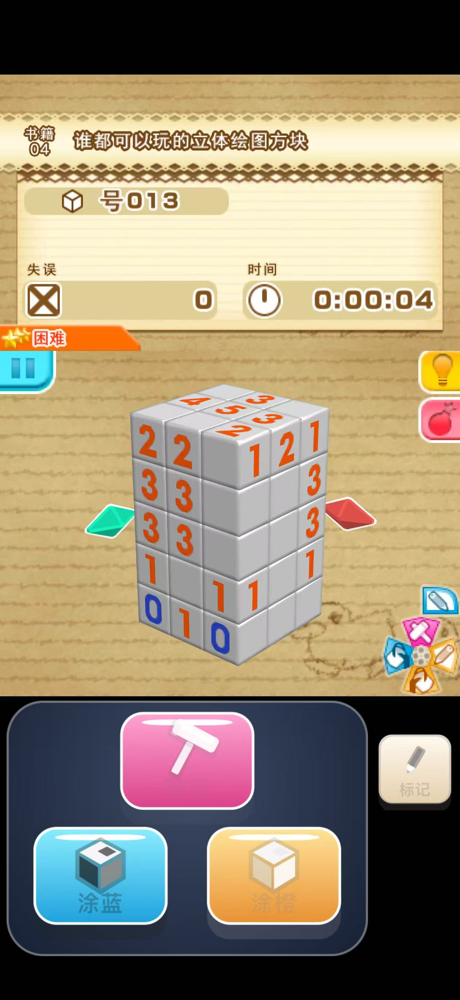

# 立体绘图方块 2 手机移植补丁工具

[中文](#中文) · [English](#english)

## 中文

本项目提供 3DS 游戏《立体绘图方块 2》的手机移植补丁工具，用于生成 Android 和 iOS 游戏安装包，并适配触摸操作。

**请自行准备 ACG 汉化版原游戏 CIA 文件。**补丁工具需要匹配的游戏版本，本仓库不提供原游戏 CIA。

### 下载

从 [Releases](../../releases) 下载适合电脑系统的工具。

- BBPJ-CIA-to-APK-v1.4.0.exe：Windows 版 Android 补丁工具，生成 APK。
- BBPJ-CIA-to-IPA-Windows-x64.exe：Windows x64 版 iOS 补丁工具，生成 IPA。
- BBPJ-CIA-to-IPA-macOS.dmg：macOS 版 iOS 补丁工具，生成 IPA。

### Android

1. 在 Windows 电脑打开 Android 补丁工具，将 ACG 汉化版 CIA 拖入程序窗口或 EXE 图标，也可在窗口选择 CIA。
2. 等待生成完成，在 CIA 所在文件夹找到 APK。
3. 将 APK 传到 Android 设备并按设备提示安装。

### iPhone / iPad

1. 打开电脑对应的 iOS 补丁工具，选择 ACG 汉化版 CIA 并按提示生成 IPA。macOS 用户先打开 DMG。
2. 使用适用于设备的 IPA 签名和侧载方式安装。安装要求取决于设备和签名方式。

游戏支持触摸操作和工具快捷选择。实际运行效果取决于设备性能和系统兼容性。请备份存档。

## English

This project provides patching tools for a mobile port of the Nintendo 3DS game **Picross 3D: Round 2**, producing Android and iOS installation packages with touch controls.

**You must supply your own ACG Chinese-patched CIA.** The original CIA is not included. The patchers require a matching game version.

### Downloads

Get the appropriate tool for your computer from [Releases](../../releases).

- BBPJ-CIA-to-APK-v1.4.0.exe — Android patcher for Windows, produces an APK.
- BBPJ-CIA-to-IPA-Windows-x64.exe — iOS patcher for Windows x64, produces an IPA.
- BBPJ-CIA-to-IPA-macOS.dmg — iOS patcher for macOS, produces an IPA.

### Android

1. On Windows, open the Android patcher and drag the ACG Chinese-patched CIA onto its window or EXE icon, or select it in the window.
2. Wait for the APK to be generated alongside the CIA.
3. Transfer the APK to your Android device and follow the installation prompts.

### iPhone / iPad

1. Open the iOS patcher for your computer, select the ACG Chinese-patched CIA, and follow the prompts to generate the IPA. Open the DMG first on macOS.
2. Sign and sideload the IPA using a method compatible with your device. Requirements depend on your device and signing method.

The mobile interface supports touch controls and quick tool selection. Performance and compatibility depend on the device. Back up your saves.
